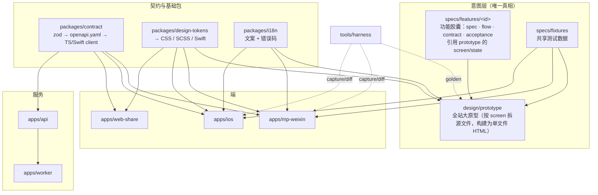
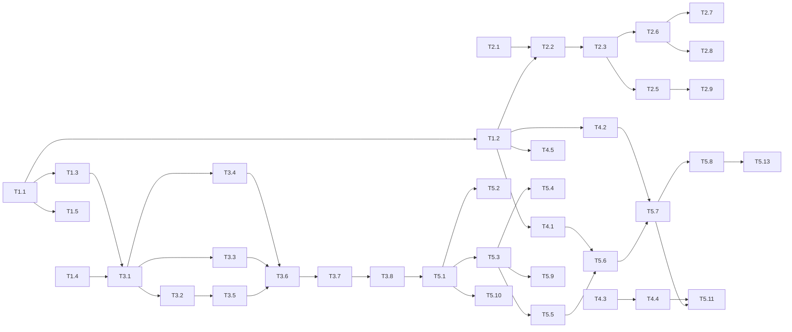

# 随哼 · iOS 端与多端架构开发计划（v2 · 可执行版）

> 状态：**Ready for Dev** · v2 · 2026-10-28
> 基线：`main@d24afe0`。v1（选型推导与方案对比）见本文件 git 历史，本版只保留结论 + 可执行规范 + 任务清单。

---

## 0. 已确认决策

| # | 决策 | 结论 | 来源 |
|---|---|---|---|
| D1 | 仓库形态 | 同一 monorepo，新增 `apps/ios`、`apps/web-share`、`design/prototype`、`specs/`、`tools/harness` | v1 |
| D2 | iOS 技术栈 | 原生 SwiftUI（iOS 17+，Swift 6），小程序继续 Taro；共享「意图层」而非 UI 代码 | v1 |
| D3 | 账号打通 | iOS 弹出微信登录，直接进入小程序原来的那条用户。作品、录音、配额不迁移、不复制。unionid 只用来认出同一个人。Apple 登录以后再绑到这个微信用户上 | E 确认，2026-10-28 |
| D4 | UI 基准 | **全站一个大原型**（`design/prototype`），功能胶囊只引用其中的 screen/state | E 确认 |
| D5 | 多端适配 | Feature Capsule + Harness（结构/文案/视觉三层比对 + Parity 报告） | v1 |
| D6 | 本期范围 | iOS（不含 Android/Web App）；首版不收费（不接 IAP）；保留扩展位 | v1 假设，未被否定 |

---

## 1. 范围

**本期交付（In）**
1. 后端：签名鉴权、小程序与 iOS 共用同一个微信用户（不迁移作品）、`/v1` 契约、预签名直传、SSE 进度、APNs/Live Activity 推送、公开分享 H5。
2. 小程序：切到 `/v1` + token 鉴权，接入 Harness（`data-ui` 锚点 + Fixture 模式）。
3. 全站原型 + Harness MVP（golden / capture / diff / report）。
4. iOS App：与小程序功能对齐 + Live Activity + App Intents + 微信分享，TestFlight → 上架。

**不做（Out）**：Android、IAP/会员、多语言（结构预留 en）、浅色主题（Token 预留）。

---

## 2. 架构总览



目标目录（新增项标 `+`）：

```
demo2song/
├─ apps/
│  ├─ api/ worker/ mp-weixin/
│  ├─ + web-share/                 # 公开试听 H5 + apple-app-site-association
│  └─ + ios/                       # SwiftUI App
├─ packages/
│  ├─ shared/ config/ data/
│  ├─ + contract/                  # zod schemas → openapi.yaml + TS client
│  ├─ + design-tokens/
│  └─ + i18n/
├─ + design/prototype/             # 全站大原型（§4）
├─ + specs/
│  ├─ features/<id>/               # 功能胶囊（§5）
│  ├─ fixtures/                    # 共享 Fixture
│  ├─ golden/                      # 原型渲染基准截图（git-lfs）
│  ├─ platform-adapters.md
│  └─ parity.yaml
└─ + tools/harness/                # Harness CLI（§6）
```

---

## 3. 账号与鉴权 Spec（同一个微信账号）

### 3.1 外部前置（E 负责，§9 有时间点）

1. 注册**微信开放平台**开发者账号并完成开发者资质认证（与小程序**同一主体**）。
2. 开放平台 →「管理中心 → 小程序」绑定现有小程序。绑定后 `jscode2session` 会返回 `unionid`。
3. 开放平台创建**移动应用**（iOS）：需填 Bundle ID 与 Universal Link（依赖 X2、X4），审核通过后获得 `WECHAT_OPEN_APP_ID / SECRET`。
4. Apple Developer：Bundle ID 开启 Sign in with Apple、Push Notifications、Associated Domains；生成 APNs Auth Key（.p8）和 Sign in with Apple Key（.p8，用于注销时 revoke）。

### 3.2 数据模型（`packages/data/src/types.ts`）

```ts
export type IdentityProvider = "wechat_mp" | "wechat_app" | "apple";

export interface UserRecord extends BaseRecord {
  openId?: string;            // 只存小程序 openid。iOS 登录不写这个字段
  sessionKey?: string;        // 兼容字段
  displayName?: string;
  mergedInto?: string;        // 被合并后指向存活用户
  deletedAt?: string;
}

export interface IdentityRecord extends BaseRecord {
  userId: string;
  provider: IdentityProvider;
  subject: string;            // mp openid / app openid / apple sub；(provider, subject) 唯一
  unionId?: string;           // 仅微信两类身份有
  meta?: Record<string, unknown>;  // apple: email(私密中继)、refreshToken(加密存储)
}

export interface SessionRecord extends BaseRecord {
  userId: string;
  client: "mp" | "ios" | "web";
  refreshTokenHash: string;   // sha256
  expiresAt: string;
  revokedAt?: string;
  replacedBy?: string;        // refresh 轮换链，检测重放
}

export interface MergeLogRecord extends BaseRecord {
  survivorUserId: string;
  absorbedUserId: string;
  status: "pending" | "done" | "failed";
  movedCounts?: Record<string, number>;
  error?: string;
}
```

新增集合：`identities`、`sessions`、`merge_logs`（加入 `packages/data/scripts/init-cloudbase.ts`）。

`Demo2SongRepository` 新增方法：

```ts
findIdentity(provider: IdentityProvider, subject: string): Promise<IdentityRecord | null>;
findIdentityByUnionId(unionId: string): Promise<IdentityRecord | null>;
listIdentitiesForUser(userId: string): Promise<IdentityRecord[]>;
createIdentity(input: Omit<IdentityRecord, keyof BaseRecord>): Promise<IdentityRecord>;
updateIdentity(id: string, patch: Partial<IdentityRecord>): Promise<void>;
createUser(input?: Partial<UserRecord>): Promise<UserRecord>;
updateUser(id: string, patch: Partial<UserRecord>): Promise<void>;
createSession(input: Omit<SessionRecord, keyof BaseRecord>): Promise<SessionRecord>;
findSessionByHash(hash: string): Promise<SessionRecord | null>;
updateSession(id: string, patch: Partial<SessionRecord>): Promise<void>;
revokeSessionsForUser(userId: string): Promise<void>;
reassignUserData(fromUserId: string, toUserId: string): Promise<Record<string, number>>; // recordings/songs/song_jobs/usage_quotas
countActiveJobsForUser(userId: string): Promise<number>;
createMergeLog(...)/updateMergeLog(...)
```

> COS 对象 key 中含旧 userId（`recordings/{userId}/...`），**合并时不搬对象**，key 视为不透明字符串。

### 3.3 Token

- 库：`jose`。算法 HS256，密钥 `JWT_SECRET`（≥32 字节，进 `.env` 与云托管环境变量）。
- Access：15 分钟，claims `{ sub: userId, cli: "mp"|"ios"|"web", sid: sessionId }`。
- Refresh：随机 32 字节 base64url，30 天，**每次刷新轮换**；旧 refresh 再次使用 → 吊销整条会话链（重放检测）。
- `apps/api/src/auth/require-user.ts`：Fastify `preHandler`，解析 `Authorization: Bearer`，校验 session 未吊销、user 未 `mergedInto`/`deletedAt`，挂 `request.userId`。
- 过渡开关 `LEGACY_HEADER_AUTH`（默认 `true`）：为 `true` 时**仅旧路由**（非 `/v1`）接受 `x-user-id`。`/v1` 永远只认 Bearer。

### 3.4 接口

| 方法 | 路径 | Body | 返回 |
|---|---|---|---|
| POST | `/v1/auth/wechat-mp` | `{code}` | `AuthResult` |
| POST | `/v1/auth/wechat-app` | `{code}` | `AuthResult` |
| POST | `/v1/auth/apple` | `{identityToken, authorizationCode, fullName?}` | `AuthResult` |
| POST | `/v1/auth/refresh` | `{refreshToken}` | `AuthResult` |
| POST | `/v1/auth/logout` | — | `204` |
| GET  | `/v1/me` | — | `Me` |
| POST | `/v1/me/identities` | `{provider:"wechat_app"\|"apple", code \| identityToken...}` | `Me` 或 `409 MERGE_REQUIRED` |
| POST | `/v1/me/merge` | `{mergeToken}` | `AuthResult`（新 token，属于存活用户） |
| DELETE | `/v1/me` | — | `204` |

```ts
interface AuthResult { accessToken: string; refreshToken: string; expiresIn: number; user: Me; }
interface Me { id: string; displayName?: string; identities: Array<{ provider: IdentityProvider; linkedAt: string }>; }
interface MergeRequired { error: { code: "MERGE_REQUIRED"; params: {
  mergeToken: string;            // 10 分钟有效 JWT：{absorbed, survivor, provider, subject, unionId}
  target: { songCount: number; recordingCount: number; lastActiveAt: string };
  current: { songCount: number; recordingCount: number };
}}}
```

### 3.5 登录解析算法（`apps/api/src/auth/resolve-user.ts`）

```
resolveWechat(provider, openid, unionid?):
  1. 已有 (provider, openid) 身份 → 补写 unionid。小程序登录时，若这个 unionid 还挂在别的用户上，把那一侧的身份和作品收回当前用户
  2. provider 是 wechat_mp，且 users.openId 已存在 → 这就是原账号。挂上身份，同样把暂时挂在别处的同 unionid 数据收回来
  3. unionid 已在某个身份上 → 把本次 openid 挂到那个 userId，不新建用户
  4. 都没有 → 新建用户。小程序写入 users.openId；iOS 只建 wechat_app 身份，不把 App openid 写进 users.openId

iOS 微信登录走 1 或 3，命中的是小程序那条用户。歌曲、录音、配额仍在原来的 userId 上。

resolveApple(sub):
  idt = findIdentity("apple", sub) → 命中 return；否则新建 user + identity
```

### 3.6 绑定与合并

主路径不产生第二个账号，也不弹出合并。iOS 微信登录直接进入小程序用户。下面只用于「先用 Apple 建了另一个用户，之后才绑到已有微信」（T2.7，尚未做）。

- 场景 A：Apple 用户绑定微信 → 后端换 `unionid`：
  - unionid 无归属 → 直接给当前用户加身份；
  - unionid 已属于用户 S（通常是小程序老用户）→ 返回 `409 MERGE_REQUIRED`，**存活方 = S**（有小程序历史），被合并方 = 当前 Apple 用户 A。
- 场景 B：微信登录的用户绑定 Apple，Apple sub 已属于另一用户 → 同样走合并，存活方 = 当前微信用户。
- `POST /v1/me/merge`（幂等，可重入）：
  1. 校验 mergeToken；`countActiveJobsForUser(absorbed) > 0` → `409 JOB_IN_PROGRESS`；
  2. `createMergeLog(pending)`；
  3. `reassignUserData(absorbed → survivor)`：recordings、songs、song_jobs 改 `userId`；usage_quotas 按 `(dateKey, kind)` 累加 `used` 后删除旧行；
  4. absorbed 的全部 identities 改 `userId = survivor`，再加上本次绑定的身份；
  5. `revokeSessionsForUser(absorbed)`；`updateUser(absorbed, { mergedInto: survivor })`；
  6. mergeLog → `done`；为 survivor 签发新的 `AuthResult`。
  - 任一步失败：mergeLog → `failed`，重试从头再跑（每一步都可重复执行）。
- 客户端 UI：合并确认 sheet，展示「将把当前账号的 N 首歌并入微信账号（M 首歌）」，二次确认后才调用 merge。

### 3.7 同一份数据，不迁移

不写 `migrate-identities.ts`，不复制用户、作品或配额。小程序和 iOS 读的是同一套 `users` / `songs` / `recordings`。

小程序 openid 和 iOS 移动应用 openid 不是同一个值。微信用 unionid 表示同一个人（开放平台绑定同一主体后，两端登录都会返回它）。登录当时把 unionid 写到已有的那条用户上：现在的 `/auth/wechat-login` 也会写，不用等小程序切到 Bearer。

iOS 弹出微信登录后，用 unionid 找到这条用户，之后的请求都带着它的 userId。`users.openId` 继续只存小程序 openid。

### 3.8 注销（`DELETE /v1/me`）

软删除：`deletedAt`、吊销会话、删除 identities（释放 unionid）；Apple 身份调用 `https://appleid.apple.com/auth/revoke`；作品与录音 30 天后由 worker 定时任务清理 COS 与记录。

---

## 4. 全站大原型 Spec（`design/prototype`）

### 4.1 原则

- 对人：**一个文件看全产品**——`dist/prototype.html` 双击打开，左侧站点地图，中间设备框，右侧状态/Fixture 面板。
- 对 AI：**按 screen 拆源文件**，降低并发修改冲突；构建脚本把它们内联成单文件。
- 所有端只对齐原型，原型只使用 Token 与 i18n 文案。

### 4.2 目录

```
design/prototype/
├─ screens.yaml              # 站点地图 / screen 注册表（唯一）
├─ src/
│  ├─ shell.html             # 外壳：站点地图、设备框、状态面板、路由出口
│  ├─ runtime.js             # 路由、fixture 注入、data-copy 绑定、intent 桩、capture 模式
│  ├─ components.css         # 共享组件：.btn .chip .card .sheet .toast .player .skeleton …
│  ├─ components.js          # 共享组件行为（波形、播放器进度、sheet 手势）
│  └─ screens/
│     ├─ record.html          ├─ compose.html          ├─ generating.html
│     ├─ demo-result.html     ├─ song.html             ├─ full-compose.html
│     ├─ library.html         ├─ share-landing.html    ├─ consent-voiceprint.html
│     ├─ login.html           └─ account.html
├─ build.mjs                 # 内联 tokens.css(生成) + copy(生成) + fixtures + 全部 screens → dist/prototype.html
└─ dist/prototype.html       # 提交到仓库；CI 校验与源码一致
```

### 4.3 `screens.yaml`

```yaml
screens:
  - id: record
    title: 哼唱录音
    states: [idle, permission-denied, recording, too-short, recorded]
    default-fixture: user-new
    platforms:
      mp-weixin: { page: pages/index/index, query: { screen: record } }
      ios: { view: RecordView }
  - id: compose
    title: 补充信息
    states: [empty, filled, long-text, uploading, submitting, error-quota, error-network]
    platforms:
      mp-weixin: { page: pages/index/index, query: { screen: details } }
      ios: { view: ComposeView }
  - id: full-compose
    title: 生成完整版
    states: [idle, drafting, draft-ready, submitting, error-quota, error-network]
    platforms:
      mp-weixin: { page: pages/full/index }
      ios: { view: FullComposeView }
  - id: login
    title: 登录
    states: [idle, signing-in, error, merge-required]   # merge-required 仅 Apple 冲突（T2.7）；微信登录不走合并
    platforms:
      mp-weixin: n/a                       # 小程序静默登录
      ios: { view: LoginView }
  # … generating / demo-result / song / library / share-landing / consent-voiceprint / account
```

Harness、端 agent、Parity 报告都从这里读 screen ↔ 页面映射。

### 4.4 Screen 文件约定

```html
<!-- design/prototype/src/screens/full-compose.html -->
<template data-screen="full-compose">
  <header class="nav" data-ui="full-compose.nav"> … </header>
  <section data-when="idle drafting draft-ready submitting">
    <h1 data-ui="full-compose.title" data-bind="draft.title" data-copy="fullCompose.titlePlaceholder"></h1>
    <div class="skeleton" data-ui="full-compose.skeleton" data-when="drafting"></div>
    <textarea data-ui="full-compose.lyrics" data-bind="draft.lyrics"></textarea>
    <button class="btn primary" data-ui="full-compose.submit" data-intent="submit"
            data-copy="fullCompose.submit"></button>
  </section>
  <div class="sheet" data-when="error-quota" data-ui="full-compose.quota-sheet">
    <p data-copy="errors.DAILY_FULL_QUOTA_EXHAUSTED"></p>
  </div>
</template>
<script type="module">
  Proto.screen("full-compose", {
    on: { "full-compose.submit": ({ go }) => go("generating", { state: "queued" }) }
  });
</script>
```

- `data-ui`：`<screen>.<element>`，同一 screen 内唯一；**各端必须使用同一 ID**（小程序 `data-ui`，iOS `accessibilityIdentifier`）。
- `data-when`：在哪些 state 下可见；`data-bind`：从 fixture 取值；`data-copy`：i18n key。
- `data-intent`：意图（share / save-file / notify-when-done / hold-to-record / submit / back…），对应 `specs/platform-adapters.md`。
- 禁止裸色值、裸字号、裸间距（lint：只允许 `var(--d2s-*)`）。

### 4.5 URL 协议

```
dist/prototype.html#/full-compose?state=draft-ready&fixture=long-lyrics&device=iphone-15&capture=1
```

`device`：`iphone-15`（390×844）、`iphone-se`（375×667）、`mp-750`（375×812，小程序胶囊导航）；`capture=1` 隐藏外壳只渲染设备内容，供截图。

### 4.6 防冲突规则

1. 一个 screen 一个文件；胶囊只改它声明的 screens。
2. 修改 `components.css/js`、`runtime.js`、`screens.yaml` 必须在胶囊 `feature.yaml` 的 `prototype.shared-changes` 中声明，Harness 会对受影响的**所有** screen 重跑 golden。
3. `dist/prototype.html` 只由 `build.mjs` 生成，冲突时直接重新构建。

---

## 5. Feature Capsule Spec（引用式）

```
specs/features/<id>/
├─ feature.yaml
├─ spec.md            # 用户故事、规则、边界、心理学依据
├─ flow.json          # 状态机（生成 TS 与 Swift）
├─ contract.yaml      # OpenAPI 片段（可空）
├─ copy.json          # 新增/修改的文案 key（合入 packages/i18n）
├─ fixtures/          # 新增 fixture（合入 specs/fixtures）
└─ acceptance.yaml    # 验收场景
```

```yaml
# feature.yaml
id: full-song-lyrics-draft
title: 完整版歌词草稿
platforms: [api, mp-weixin, ios]
prototype:
  screens:
    full-compose: [idle, drafting, draft-ready, submitting, error-quota, error-network]
  shared-changes: []                 # 例如 [components.css#.sheet]
contract: contract.yaml
flags: { server: features.enableExtendSong }
divergence:
  - platform: ios
    ui-id: full-compose.submit
    reason: 系统 borderedProminent 按钮 50pt
    visual-tolerance: 0.04
  - platform: mp-weixin
    ui-id: full-compose.nav
    reason: 小程序原生导航栏
    skip: [visual]
```

`flow.json` 只支持 `states / on / invoke / initial`，`#<screen>` 表示跳转。`acceptance.yaml` 的 step 词汇表：`tap / type / expect{state,screen,visible,hidden,text,copy} / mock / wait`。

---

## 6. Harness Spec（`tools/harness`）

Node 20 + TS，入口 `yarn harness <cmd>`。

| 命令 | 作用 | 产物 |
|---|---|---|
| `feature new "<需求>"` | 生成胶囊骨架，写 `feature.yaml/spec.md`，并在原型新增/修改 screen 源文件（由 agent 完成内容） | `specs/features/<id>/` |
| `codegen` | contract → openapi.yaml → TS client / Swift client；tokens → css/scss/swift；i18n → ts/xcstrings；flow → ts/swift | 各 `generated/` 目录 |
| `proto build` | 构建 `dist/prototype.html` | |
| `golden [--feature id]` | Playwright 渲染 screen×state×device | `specs/golden/<screen>/<state>@<device>.png` + `.tree.json` |
| `capture --platform mp\|ios [--feature id]` | 用同一 fixture 截各端图并导出 ui 节点树 | `.harness/captures/<platform>/…` |
| `diff [--feature id]` | 结构 → 文案 → 视觉三层比对；视觉低于阈值调用 AI 评审 | `.harness/diff/*.json` |
| `report` | 汇总 parity，更新 `specs/parity.yaml` | `.harness/report/parity.html` |
| `verify --feature id` | codegen + build + test + acceptance + capture + diff（CI 入口） | 退出码 |

比对规则：
1. **结构**（硬）：golden 中可见的 `data-ui` 集合与相对顺序 = 端节点树（去除 `divergence.skip`）。
2. **文案**（硬）：`data-copy` 元素文本 = i18n 值。
3. **视觉**（软）：按 `data-ui` 框对齐后区域 SSIM ≥ 0.92（或胶囊声明的容差）；不达标交给视觉评审 agent，按 rubric（层级 / 8pt 节奏 / Token / 字号级 / 对齐 / 状态完整）输出 `accept | fix + 指令`。

采集方式：
- 原型：Playwright（Chromium，DPR 3）。
- 小程序：`miniprogram-automator` 连开发者工具（端口见 `Agent.md`，57488）；页面 query `__fixture=<name>&__state=<state>`，`request.ts` 中 `FixtureTransport` 拦截；构建开关 `TARO_APP_HARNESS=1`（生产构建剔除）。
- iOS：XCUITest，启动参数 `-harness -screen X -state Y -fixture Z`；`FixtureTransport` 替换网络；关闭动画，固定时钟 `2026-01-01T20:00:00+08:00`；`simctl` 模拟器 iPhone 15 / iPhone SE（3rd）。

---

## 7. 其他后端 Spec（iOS 前置）

### 7.1 `/v1` 与契约

- `packages/contract/src/schemas/*.ts`：迁入 `apps/api/src/routes/songs.ts` 中的 `promptSchema / demoJobSchema / fullJobSchema / fullDraftSchema` 以及 `packages/shared/src/types.ts` 中对外的类型（以 zod 重写，`z.infer` 导出 TS 类型，`shared` 再从 contract 转导出保持兼容）。
- `@asteasolutions/zod-to-openapi` 生成 `packages/contract/openapi.yaml`；API 用 `fastify-type-provider-zod` 直接校验。
- 统一错误：`{ error: { code: string; params?: object } }`；HTTP 状态不变。错误码清单进 `packages/i18n/errors.json`。
- 旧路由保留，内部复用同一 handler，旧路由继续返回旧错误格式。

### 7.2 直传上传

```
POST /v1/recordings/upload-url   {mimeType: "audio/mp4"|"audio/mpeg"|"audio/wav", byteSize, durationSeconds}
  → {recordingId, putUrl, headers, expiresAt}       # COS 预签名 PUT，10 分钟，限制 Content-Length ≤ 20MiB
PUT  putUrl                                          # 客户端直传
POST /v1/recordings/{id}/complete                    → Recording（服务端 headObject 校验大小与类型）
```

worker 的 `normalizeReferenceAudioToMp3` 需接受 `audio/mp4`（m4a）。

### 7.3 进度推送

- `GET /v1/jobs/{id}/events`：SSE，事件 `status`（`queued | running | succeeded | failed`，含 `etaSeconds?`、`songId?`、`error?`），15s 心跳；服务端每 2s 读库推送变化（后续可换消息队列）。
- `POST /v1/jobs/{id}/subscriptions` `{channel: "wechat_subscribe" | "apns" | "apns_live_activity", token?}`，替代 `/jobs/:id/notification`。
- `SongJobRecord` 新增 `subscriptions: Array<{channel, token?, sentAt?, error?}>`，保留 `notificationAccepted` 一个版本做兼容。
- worker：`apps/worker/src/notifiers/{index,wechat,apns}.ts`，`Notifier` 接口；APNs 用 HTTP/2 + .p8 token 鉴权（`APNS_KEY_ID / APNS_TEAM_ID / APNS_PRIVATE_KEY / APNS_BUNDLE_ID / APNS_ENV`）。Live Activity：状态变化时推 `event: update`，完成时 `event: end` + `dismissal-date`。
- 设备注册：`POST /v1/me/devices {apnsToken, env}`，用于非 Live Activity 的完成通知。

### 7.4 其余

- `GET /v1/songs` 去 N+1：repository 新增 `listSongsWithStats(userId)`（一次取 songs + jobs，在内存聚合 `hasReadyFull`、`jobId`）。
- `/v1/config/public` 新增 `options: { styles, moods, languages, genders }`（从 `apps/mp-weixin/src/constants.ts` 上移到 `demo2song.config.json`）。
- `apps/web-share`：静态 H5（Vite + 原生 TS 即可），路由 `/p/{songId}` 调 `/v1/public/songs/{id}`；托管 `/.well-known/apple-app-site-association`（`applinks` 匹配 `/p/*`、`/wx/*`，后者为微信 Universal Link）；在微信内显示「打开小程序」开放标签。建议域名 `s.demo2song.eexx.me`（待 E 确认）。
- AI 生成标识：worker 转存歌曲时写 ID3 `TXXX:AIGC=true`（m4a 写对应 tag），播放页显式展示「AI 生成」。

---

## 8. iOS Spec

### 8.1 工程

```
apps/ios/
├─ project.yml                     # XcodeGen；.xcodeproj 不入库
├─ Config/{Debug,Release}.xcconfig # API_BASE、WECHAT_OPEN_APP_ID、UNIVERSAL_LINK
├─ App/                            # SuihengApp.swift、AppRouter、DI(Environment)
├─ Packages/
│  ├─ D2SContract/   (generated)   # swift-openapi-generator
│  ├─ D2SDesign/                   # Generated/Tokens.swift + 手写组件 PrimaryButton/Chip/Card/Sheet/Toast/Waveform
│  ├─ D2SStrings/    (generated)   # Localizable.xcstrings + ErrorCode → 文案
│  ├─ D2SFlows/      (generated)   # flow.json → enum + reducer
│  ├─ D2SCore/                     # AuthStore(Keychain)、APIClient(自动刷新/401 重试)、FixtureTransport、SSEClient
│  ├─ D2SAudio/                    # Recorder(AVAudioEngine→AAC 128k)、Player(AVPlayer+NowPlaying)
│  └─ D2SFeatures/                 # Login Record Compose Generating DemoResult Song FullCompose Library Account Consent
├─ Extensions/
│  ├─ GenerationActivity/          # ActivityKit + 灵动岛
│  ├─ Widgets/                     # 锁屏/桌面「哼一段」+ iOS 18 Control
│  └─ (App Intents 放主 target)
└─ UITests/                        # Harness 采集 + acceptance 生成用例
```

- 依赖：swift-openapi-generator / runtime / urlsession、swift-snapshot-testing、微信 OpenSDK（SPM 或 xcframework）。
- 状态管理：`@Observable` ViewModel 持有 `D2SFlows` 生成的状态机；View 只读状态、发事件。
- 所有 `data-ui` 对应 `.accessibilityIdentifier("full-compose.submit")`，常量由 codegen 从原型提取生成 `UIID.swift`，杜绝拼写漂移。

### 8.2 关键交互（相对小程序的重新定义）

| 原方式 | iOS 新方式 | 依据 |
|---|---|---|
| 停在生成页 2.5s 轮询 | 提交后可离开；Live Activity / 灵动岛显示「排队 → 编曲中（ETA）→ 完成，点按试听」；前台用 SSE | 预期管理、蔡格尼克效应、峰终定律 |
| 打开 App 才能录 | App Intent「用随哼录一段」、锁屏 Widget、Control、Action Button 直达 `record.recording`；录完存为草稿，补充信息可稍后 | 渐进式披露；灵感窗口短，缩短入口路径 |
| 按住录音（松手即停） | 按住录音 + 上滑锁定免按；实时电平/音高线 | 即时反馈、降低持续按压负担（费茨定律之外的操作成本） |
| 分享为小程序卡片 | 系统 ShareLink（H5 链接）+ 微信内直接分享为小程序卡片 | 默认值效应：收件人在微信内零跳转 |

以上差异在对应胶囊 `divergence` 中声明；小程序保持原交互。

---

## 9. 开发任务清单

> 编号 = 建议的子 issue。**依赖** 列出必须先完成的任务。每个任务都要满足 §10 的通用 DoD。
> 角色：`BE` 后端 · `MP` 小程序 · `PX` 原型/设计工程 · `HX` Harness · `IOS` iOS · `E` 需要你本人操作。

### 实现进度（2026-10-28）

已落地：T1.1、T1.2、T1.3、T1.4、T1.5、T2.1、T2.2、T2.3。T2.4 取消（不迁数据，登录直接命中原用户）。

尚未开始：T2.5–T2.9（T2.6 中的微信 App 登录已随 T2.3 完成，剩下 Apple）、T3.1–T3.8、T4.1–T4.7、T5.1–T5.13、T6.1–T6.4，以及外部前置 X1–X6。

### 9.0 外部前置（E）

| ID | 事项 | 最晚需要的时间点 |
|---|---|---|
| X1 | 开放平台账号认证 + 绑定小程序（§3.1-1/2） | M2 上线前（否则 unionid 拿不到） |
| X2 | Apple Developer 账号；确定 Bundle ID；开启 SIWA / Push / Associated Domains | M5 开始前 |
| X3 | APNs .p8、SIWA .p8；写入云托管环境变量 | M4-T4.4 / M2-T2.8 |
| X4 | Universal Link 域名（建议 `s.demo2song.eexx.me`）解析到 web-share | M4-T4.6 |
| X5 | 开放平台创建 iOS 移动应用（依赖 X2、X4） | M5-T5.4 |
| X6 | App 备案（ICP）、生成式 AI 合规材料、隐私政策更新 | M6 前 |

### 9.1 M1 · 契约与基础包

| ID | 角色 | 依赖 | 内容 | 验收 |
|---|---|---|---|---|
| T1.1 | BE | — | 新建 `packages/contract`：zod schemas（§7.1）、`openapi.yaml` 生成脚本 `yarn contract:build`；`packages/shared` 对外类型改为从 contract 转导出 | `yarn contract:build` 产物稳定；`yarn typecheck && yarn test` 通过；`npx @redocly/cli lint openapi.yaml` 0 error |
| T1.2 | BE | T1.1 | API 引入 `fastify-type-provider-zod`；新增 `/v1` 前缀注册全部现有路由（共享 handler）；`/v1` 使用统一错误格式 | `apps/api/src/app.test.ts` 新增 `/v1` 用例并通过；旧路由行为不变 |
| T1.3 | BE | T1.1 | `packages/i18n`：`zh-Hans.json`（文案）、`errors.json`（错误码→文案）；生成 `ts` 与 `xcstrings` | 所有现有后端错误码在字典中有条目（测试校验） |
| T1.4 | PX | — | `packages/design-tokens`：从 `apps/mp-weixin/src/styles/theme.scss` 与 `docs/prototype/index.html` `:root` 抽取为 DTCG `tokens.json`；Style Dictionary v4 输出 `css`、`scss`（rpx = px×2）、`swift` | 生成物入库；小程序 `theme.scss` 改为引用生成变量后视觉无变化（截图对比） |
| T1.5 | BE | T1.1 | `@demo2song/contract-client`：`openapi-typescript` + `openapi-fetch`，供小程序/web-share 使用 | 类型生成通过；示例调用单测 |

### 9.2 M2 · 账号与鉴权

| ID | 角色 | 依赖 | 内容 | 验收 |
|---|---|---|---|---|
| T2.1 | BE | — | 数据模型与 repository 方法（§3.2），memory + cloudbase 双实现；`init-cloudbase.ts` 加集合 | `packages/data` 单测覆盖全部新方法 |
| T2.2 | BE | T1.2, T2.1 | `jose` JWT、`require-user` preHandler、refresh 轮换与重放检测、`LEGACY_HEADER_AUTH`；env 增 `JWT_SECRET` | 单测：过期/篡改/重放/吊销/mergedInto 均 401 |
| T2.3 | BE | T2.2 | `/v1/auth/wechat-mp`、`/v1/auth/wechat-app`（同一 userId）+ 解析算法 §3.5 + `/v1/auth/refresh` `/logout` `/v1/me`；现有 `/auth/wechat-login` 同时写入 unionid | 单测覆盖 §3.5 四条分支；iOS 登录后作品仍在原用户上 |
| T2.4 | — | — | **取消。** 不做 `migrate-identities.ts`。两端共用同一条用户和同一批作品（§3.7） | 小程序老用户用另一个 openid 的微信 App 登录，userId 不变 |
| T2.5 | MP | T2.3, T1.5 | 小程序改用 `/v1` + Bearer：token 存 Storage、自动刷新、401 重试一次；移除 `x-user-id` | 本地 E2E（`Agent.md` 流程）全通；发版 |
| T2.6 | BE | T2.3 | `/v1/auth/apple`（Apple JWKS，`aud`=Bundle ID）。微信 App 登录已在 T2.3 完成。env 增 `APPLE_BUNDLE_ID`（`WECHAT_OPEN_APP_ID/SECRET` 已预留） | 单测（mock JWKS） |
| T2.7 | BE | T2.6 | `/v1/me/identities`、`/v1/me/merge`（§3.6），`reassignUserData` | 单测：无冲突绑定、两种合并、进行中任务拒绝、merge 重入幂等、配额累加 |
| T2.8 | BE | T2.6 | `DELETE /v1/me`（§3.8）+ worker 定时清理 | 单测；Apple revoke 用 mock |
| T2.9 | BE | T2.5 发版 ≥ 2 周 | 生产 `LEGACY_HEADER_AUTH=false` | 伪造 `x-user-id` 请求 → 401 |

### 9.3 M3 · 全站原型 + Harness MVP

| ID | 角色 | 依赖 | 内容 | 验收 |
|---|---|---|---|---|
| T3.1 | PX | T1.3, T1.4 | `design/prototype` 骨架：shell、runtime（路由/URL 协议/fixture/data-copy/data-when）、`build.mjs`、`screens.yaml` | 双击 `dist/prototype.html` 可切换 screen/state/device；`capture=1` 只渲染设备内容 |
| T3.2 | PX | T3.1 | **以现有小程序为基线**还原全部 screen（record / compose / generating / demo-result / song / full-compose / library / share-landing / consent-voiceprint）及全部状态；迁移并废弃 `docs/prototype/index.html` | E 评审通过（只看原型） |
| T3.3 | PX | T3.1 | `specs/fixtures`：user-new、user-with-songs、song-demo-ready、song-full-ready、job-queued/running/failed、long-lyrics、empty-library、many-songs(50) | 原型全部 state 都有可用 fixture |
| T3.4 | HX | T3.1 | `tools/harness`：`proto build`、`golden`（Playwright） | 生成 `specs/golden/**`，重复运行无 diff |
| T3.5 | MP | T3.2 | 小程序加 `data-ui`（与原型一致）、`FixtureTransport` + `__fixture/__state` 注入（`TARO_APP_HARNESS=1`） | 生产构建 dist 中不含 harness 代码（grep 校验） |
| T3.6 | HX | T3.4, T3.5 | `capture --platform mp`（miniprogram-automator）、`diff`（结构/文案/SSIM）、`report` | 首份 mp parity 报告；结构/文案全绿 |
| T3.7 | HX | T3.6 | 视觉评审 agent（rubric prompt + 输出 schema）、`verify` 命令、CI workflow（PR 触发 golden + diff 报告作为 artifact） | 人为改坏一个按钮颜色能被识别并给出修复指令 |
| T3.8 | HX | T3.7 | `feature new`、胶囊模板、`specs/platform-adapters.md`、`specs/AGENTS.md`、`apps/*/AGENTS.md` | 用一个小需求（如「歌曲页显示 AI 生成标识」）全流程跑通 |

### 9.4 M4 · iOS 所需后端能力

| ID | 角色 | 依赖 | 内容 | 验收 |
|---|---|---|---|---|
| T4.1 | BE | T1.2 | 预签名直传（§7.2）+ worker 支持 m4a | 单测；本地 E2E 用 m4a 文件跑通 mock 生成 |
| T4.2 | BE | T1.2 | SSE `/v1/jobs/{id}/events` | 集成测试：状态变化在 ≤3s 内送达；断线重连 |
| T4.3 | BE | T2.2 | subscriptions + devices 接口；`notificationAccepted` 兼容 | 单测 |
| T4.4 | BE | T4.3, X3 | worker `Notifier`：wechat（迁移现有）、apns、apns_live_activity | 沙盒环境真机收到通知与 Live Activity 更新 |
| T4.5 | BE | T1.2 | `listSongsWithStats` 去 N+1；`/v1/config/public` 下发 options | 50 首歌列表接口 P95 显著下降（记录前后数据） |
| T4.6 | BE | T1.5, X4 | `apps/web-share` + AASA + 部署 | 浏览器打开 `/p/{id}` 可试听；AASA 校验通过 |
| T4.7 | BE | — | AI 生成标识写入音频 tag | worker 单测读回 tag |

### 9.5 M5 · iOS App

| ID | 角色 | 依赖 | 内容 | 验收 |
|---|---|---|---|---|
| T5.1 | IOS | T1.1, T1.3, T1.4, X2 | XcodeGen 工程、SPM 模块、`harness codegen` 接入 Swift 生成物、`UIID.swift` 生成 | `xcodebuild build` 通过；生成物无手改（CI diff 校验） |
| T5.2 | IOS | T5.1 | `D2SDesign` 组件库 + 组件截图测试 | 每个组件对照原型 `components.css` 截图 |
| T5.3 | IOS | T5.1 | `D2SCore`：Keychain AuthStore、APIClient（自动刷新）、FixtureTransport、SSEClient | 单测 |
| T5.4 | IOS | T5.3, T2.6, X5 | Login：微信登录后即小程序原账号；Sign in with Apple 绑到同一用户，仅冲突时走 `login.merge-required` | 真机微信登录看到原有作品 |
| T5.5 | IOS | T5.3 | `D2SAudio`：录音（AVAudioEngine、电平、锁定）、播放（NowPlaying、远程控制、后台） | 真机锁屏可控制播放 |
| T5.6 | IOS | T5.5, T4.1 | Record + Compose + 上传 | 对应胶囊 `verify` 通过 |
| T5.7 | IOS | T5.6, T4.2 | Generating（SSE）+ DemoResult | `verify` 通过 |
| T5.8 | IOS | T5.7 | Song、FullCompose、Library | `verify` 通过 |
| T5.9 | IOS | T5.3 | Consent、Account（身份列表、绑定、合并、注销） | `verify` 通过 |
| T5.10 | HX | T5.1 | `capture --platform ios`（XCUITest + simctl） | iOS parity 报告生成 |
| T5.11 | IOS | T5.7, T4.4 | Live Activity + 灵动岛 | 后台收到 push 更新并结束 |
| T5.12 | IOS | T5.6 | App Intents、锁屏/桌面 Widget、Control | 从锁屏一步进入录音 |
| T5.13 | IOS | T5.8, T4.6, X5 | 分享：ShareLink + 微信小程序卡片；Universal Link 打开 `song` | 微信内点卡片进小程序；Safari 链接唤起 App |

### 9.6 M6 · 上架

| ID | 角色 | 依赖 | 内容 |
|---|---|---|---|
| T6.1 | IOS | M5 | `PrivacyInfo.xcprivacy`、App Privacy 标签、麦克风/通知权限文案 |
| T6.2 | E | X6 | 隐私政策、用户协议、AI 生成标识说明、备案号展示 |
| T6.3 | IOS | T6.1 | TestFlight 内测（至少 1 周），修复问题 |
| T6.4 | E | T6.3 | 提审（4.8 SIWA、5.1.1(v) 注销、录音用途说明） |

### 9.7 依赖与并行



三条可并行的线：**BE（M1→M2→M4）**、**PX/HX（T1.4→M3）**、**IOS（T5.1 起，先用 FixtureTransport 开发，后端就绪后切真接口）**。建议 T5.1–T5.3 在 T3.8 完成前就启动，不阻塞。

---

## 10. 通用约定与 DoD

每个任务合并前必须满足：

1. `yarn config:validate && yarn typecheck && yarn test` 通过；涉及 iOS 时 `xcodebuild test` 通过。
2. 契约变更先改 `packages/contract`，`yarn harness codegen` 后生成物无 diff。
3. 涉及 UI：原型先改并经 E 评审 → 端实现 → 对应胶囊 `yarn harness verify --feature <id>` 通过或差异已在 `divergence` 声明。
4. 状态覆盖：空 / 加载 / 错误 / 成功 / 边界（长文本、0 条、50+ 条）在原型和端实现中都存在。
5. 不提交密钥；新增 env 同步更新 `.env.example` 与 `apps/*/src/env.ts`。
6. 后端行为变更遵循 `Agent.md` 的 E2E 流程验证后再部署。
7. 新增/修改胶囊后更新 `specs/parity.yaml`。

分支与 PR：一个任务一个分支 `feat/<task-id>-<slug>`，PR 标题前缀 `[T2.3]`；对应 Multica 子 issue。

---

## 11. 风险

| 风险 | 影响 | 应对 |
|---|---|---|
| 开放平台尚未绑定 | 两端拿不到 unionid，iOS 认不出小程序老用户 | X1 在 iOS 微信登录上线前完成。绑定之后，现有小程序登录会把 unionid 写到原用户上 |
| 绑定前只打开了 iOS | 当时库里没有 unionid，会先有一条只有 App 身份的用户 | 他下次小程序登录按 openId 回到原用户，并把这条 App 身份和期间产生的作品收回去。不跑迁移脚本，登录页也不做提示 |
| CloudBase 无跨集合事务 | 合并中途失败 | merge_logs + 每步幂等 + 可重入 |
| 原型单体变大 | 加载慢、AI 改动冲突 | 源码按 screen 拆分；防冲突规则（§4.6）；dist 只由构建生成 |
| 视觉比对误报 | Harness 噪声大、agent 反复返工 | 结构/文案硬约束，视觉软约束 + AI 评审；返工上限 3 轮后交人工 |
| SSE 在云托管网关的长连接限制 | 前台进度中断 | 客户端自动重连 + 轮询降级；必要时缩短连接周期 |
| 合规（App 备案、生成式 AI 备案、AI 内容标识） | 上架受阻 | X6 提前启动；以官方最新要求为准 |
