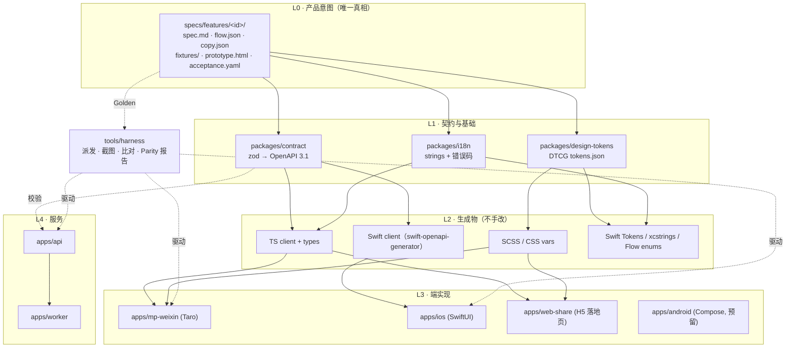
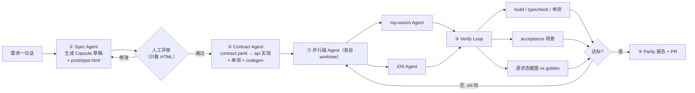

# 随哼 · iOS 端与多端架构方案（Plan + Spec）

> 状态：Draft v1 · 2026-10-27 · 只含方案，不含功能代码
> 适用仓库：`ee01/demo2song`（基于 `main@d24afe0` 源码分析）

---

## 0. 一页结论

| 问题 | 结论 |
|---|---|
| 独立仓库 or 同仓？ | **同一个 monorepo**，新增 `apps/ios`。不拆仓：AI agent 需要在一次上下文里同时看到契约、后端、各端实现和 UI 基准，拆仓会让「一个需求 → 多端改动」变成跨仓协调。 |
| 共用代码 or 跨端框架？ | **不共用 UI 代码，共用「意图层」**。iOS 用原生 SwiftUI；小程序继续 Taro。共享的是：API 契约（OpenAPI）、设计 Token、文案、状态机、Fixture 数据、HTML 黄金原型、验收用例。 |
| 为什么不用 Taro-RN / RN / Flutter / KMP 一套代码？ | 随哼的核心体验是 **录音 + 后台播放 + 长耗时生成的等待**，这三件事在 iOS 上最好的形态（AVAudioEngine 实时电平、锁屏 Now Playing、Live Activity/灵动岛、App Intents）都是原生能力；而小程序端无论如何都是一套独立 UI（Taro），「一份代码」并不能真的减少一端。既然开发成本不是约束，就用原生拿到体验上限，再用 Harness 解决「新功能多端自动适配」。 |
| 新功能怎么多端自动适配？ | **Feature Capsule + 多端 Harness**：一个需求先落成一个胶囊目录（spec / 状态机 / 契约 diff / 文案 / Fixture / **HTML 黄金原型** / 验收用例），然后由 Harness 并行派发给「后端 agent / 小程序 agent / iOS agent」，各端用同一份 Fixture 渲染截图，与 HTML 原型逐状态做结构 + 视觉比对，不达标自动回修，最后输出 Parity 报告。 |
| UI 基准用什么？ | **HTML 原型作为唯一 UI 真相（Golden）**，与你的偏好一致。仓库里已有 `docs/prototype/index.html`，它会升级为「可按状态切换、带锚点、只读 Token」的规范化原型。 |
| iOS 上线前必须改的后端问题 | ① 鉴权：现在只靠 `x-user-id` 请求头，**任何人可冒充任意用户**，必须换成签名 token；② 登录只支持微信 `jscode2session`；③ 通知只支持微信订阅消息；④ 上传受 CloudBase 网关 ~1MiB 限制；⑤ 分享落地页只存在于小程序内。详见 §3。 |

---

## 1. 理解：核心用户、任务与成功标准

- **核心用户**：有旋律灵感但不会编曲的普通人；灵感是突发的（洗澡、走路、睡前）。
- **核心任务**：哼一段（6–60s）→ 补充风格/情绪/歌词片段 → 等待生成 demo → 满意后生成完整版 → 播放 / 下载 / 分享。
- **iOS 端成功标准**：
  1. 从「想到旋律」到「开始录音」≤ 1 步（锁屏 / 灵动岛 / Siri 均可触发）；
  2. 生成等待期间可以离开 App，结果主动送达；
  3. 账号与小程序数据互通（同一个人的歌在两端都能看到）。
- **架构成功标准**：提一个需求，Harness 能在小程序与 iOS 两端产出功能一致、视觉对齐黄金原型的实现，并给出可审阅的差异报告。

> 假设（若不对请指出，会影响 §3/§8）：A1 本期只做 iOS，但架构要能低成本加 Android / Web；A2 iOS 账号需与微信小程序账号打通；A3 iOS 首版不做付费（若要卖次数，必须走 Apple IAP）。

---

## 2. 现状诊断（基于源码）

### 2.1 现有结构

```
apps/
  api/         Fastify，鉴权/上传/配额/建任务/签名 URL     → 已基本端无关
  worker/      轮询 song_jobs，调 MiniMax/Mureka，转存 COS  → 端无关
  mp-weixin/   Taro 4 + React 18，7 个页面                  → 微信专属
packages/
  shared/      TS 类型 + provider contract                   → 可升级为契约源
  config/      运营配置 + JSON Schema                        → 端无关
  data/        CloudBase repository + memory repository      → 端无关
docs/prototype/index.html   单文件原型（3 个 screen）          → 黄金原型的种子
```

结论：**后端 70% 已经是端无关的**，主要问题集中在「身份、通知、上传、分享」四个和微信强耦合的边界，以及「契约只存在于 TS 类型里，Swift 无法消费」。

### 2.2 与微信强耦合点（iOS 必须改）

| # | 位置 | 问题 | iOS 影响 |
|---|---|---|---|
| C1 | `apps/api/src/routes/*.ts` 全部 `request.headers["x-user-id"]` | 用户身份由客户端自报，无签名 | **安全漏洞**；iOS 公开分发后更易被抓包冒用 |
| C2 | `apps/api/src/routes/auth.ts` | 只有 `/auth/wechat-login`（`jscode2session`） | iOS 无法登录 |
| C3 | `packages/data/src/types.ts` `UserRecord.openId` | 用户主键语义 = 小程序 openid | iOS 微信登录拿到的是**开放平台 App openid**，与小程序 openid 不同，只有 `unionid` 相同 |
| C4 | `apps/worker/src/wechat-notification.ts` + `jobs.ts` 的 `notificationAccepted` | 完成通知只有微信订阅消息 | iOS 需要 APNs / Live Activity 推送 |
| C5 | `apps/api/src/app.ts` + 录音 64kbps 的注释 | 文件经 API 中转，受 CloudBase 网关 ~1MiB 限制 | iOS 可录更高音质（AAC 128k），需直传 COS |
| C6 | `apps/mp-weixin/src/pages/play` | 公开试听页只在小程序里 | iOS 分享出去的链接没有落地页 |
| C7 | `apps/mp-weixin` 中 `errorMessage()` 直接展示后端 `error` 字符串 | 错误码→文案映射散落在客户端 | 两端文案会漂移 |
| C8 | `GET /songs` 对每首 demo 调 `countReadyFullForDemo`，对每首调 `findJobForSongForUser` | N+1 查询 | 原生列表滑动更快暴露延迟 |
| C9 | 客户端 2.5s 轮询 `/jobs/:id` | 只有轮询 | iOS 后台被挂起后轮询失效 |

### 2.3 可直接复用的资产

- `SongPromptInput / SongBrief / SongDetail / JobDetail / PublicAppConfig` 等类型 → 契约的起点；
- `apps/api` 中的 zod schema（`promptSchema` 等）→ 可直接生成 OpenAPI；
- `PROVIDER_MOCK_MODE` + `memory` repository → Harness 的确定性 Mock 后端；
- `theme.scss` 与 `docs/prototype/index.html` 的 `:root` 变量 → Design Token 的起点；
- `constants.ts` 中的风格/情绪/语言/性别选项 → 应上移为服务端下发或共享枚举。

---

## 3. 选型对比

评分 1–5，权重按你的偏好设定（开发成本不计，**多端自动适配**与**体验上限**权重最高）。

| 方案 | 多端自动适配 (×3) | iOS 体验上限 (×3) | AI 生成质量 (×2) | 小程序复用 (×1) | 演进风险 (×1) | 加权 |
|---|---|---|---|---|---|---|
| A. 独立仓库、完全隔离 | 1 | 5 | 4 | 1 | 3 | 31 |
| **B. 同仓 · 原生 SwiftUI · 共享意图层 + Harness** | **5** | **5** | **5** | 3 | 4 | **52** |
| C. Taro 多端（weapp + Taro RN） | 3 | 2 | 2 | 5 | 2 | 30 |
| D. React Native / Expo（iOS/Android/Web）+ 小程序 Taro | 3 | 3 | 4 | 2 | 3 | 37 |
| E. Flutter + 小程序 Taro | 3 | 3 | 3 | 1 | 3 | 33 |
| F. KMP（共享逻辑）+ SwiftUI + Taro | 4 | 5 | 3 | 1 | 3 | 42 |
| G. uni-app x / 跨小程序框架一套出 App | 3 | 2 | 2 | 4 | 2 | 29 |

关键判断：

1. **「一份代码」解决不了小程序**。小程序端注定是 Taro/原生小程序，所以任何 App 侧的跨端框架都只是把「2 套 UI」变成「2 套 UI + 1 个桥」。真正的「一份」只能在 UI 之上的意图层实现。
2. **AI native 开发下，原生代码反而最好生成**：SwiftUI / Swift Concurrency 语料丰富、编译器严格、Xcode 预览与 XCUITest 可脚本化，非常适合「生成 → 编译 → 截图 → 比对 → 回修」的闭环；Taro-RN 的音频/后台能力语料少、坑多。
3. **KMP（F）不划算**：本项目业务逻辑很薄（真正的逻辑在后端），共享 Kotlin 逻辑层收益小，却引入第三种语言。用「OpenAPI 生成 + 状态机 JSON 生成」即可得到相同的一致性。
4. **B 的「适配」不靠运行时，而靠流水线**：一致性由 Harness 在开发期强制，而不是靠跨端 runtime 在运行期抹平——这正是 AI native 的优势所在。

---

## 4. 目标架构

### 4.1 分层



### 4.2 目标目录

```
demo2song/
├─ apps/
│  ├─ api/                 # + /v1、JWT、身份提供方、预签名上传、SSE、APNs
│  ├─ worker/              # + Notifier 抽象（wechat / apns / live-activity）
│  ├─ mp-weixin/           # 改为消费 @demo2song/contract-client 与 tokens
│  ├─ web-share/           # 新：公开试听 H5（Universal Link 落地 + 唤起小程序/App）
│  └─ ios/                 # 新：SwiftUI App（见 §6）
├─ packages/
│  ├─ shared/              # 保留 provider contract（服务端内部）
│  ├─ contract/            # 新：zod schemas → openapi.yaml + TS client
│  ├─ design-tokens/       # 新：tokens.json → scss / css / swift / (kotlin)
│  ├─ i18n/                # 新：copy 与错误码字典 → ts / xcstrings
│  ├─ config/  data/       # 不变
├─ specs/
│  ├─ features/<id>/       # Feature Capsule（见 §7.2）
│  ├─ fixtures/            # 全局 Fixture（用户、歌曲、任务各状态）
│  ├─ golden/              # 由 prototype.html 渲染出的基准截图（git-lfs）
│  ├─ platform-adapters.md # 意图 → 各端原生实现的映射表
│  └─ parity.yaml          # 功能 × 端 的对齐矩阵
├─ tools/harness/          # 多端 Harness CLI（见 §7）
└─ docs/architecture/      # 本文档
```

---

## 5. 后端改造 Spec（iOS 前置条件）

### 5.1 身份与账号

**目标**：签名 token 取代 `x-user-id`；一个「人」可绑定多个身份。

数据模型（`packages/data`）：

```ts
interface UserRecord extends BaseRecord {
  displayName?: string;
  // openId 字段迁移到 identities，保留只读兼容一个版本
}
interface IdentityRecord extends BaseRecord {
  userId: string;
  provider: "wechat_mp" | "wechat_app" | "apple" | "phone";
  subject: string;        // mp/app openid、apple sub、手机号哈希
  unionId?: string;       // 微信开放平台 unionid —— 打通小程序与 App 的关键
  rawMeta?: Record<string, unknown>;
}
interface SessionRecord extends BaseRecord {
  userId: string; refreshTokenHash: string; client: "mp" | "ios" | "web"; expiresAt: string;
}
```

接口：

| 方法 | 路径 | 说明 |
|---|---|---|
| POST | `/v1/auth/wechat-mp` | `{code}` → jscode2session → 按 unionid/openid 合并用户 |
| POST | `/v1/auth/wechat-app` | `{code}` → 开放平台 `sns/oauth2/access_token` → unionid 合并 |
| POST | `/v1/auth/apple` | `{identityToken, authorizationCode}` → 校验 Apple JWKS |
| POST | `/v1/auth/refresh` | refresh → 新 access token |
| POST | `/v1/me/identities` | 已登录状态下绑定新身份（Apple 用户补绑微信以找回小程序作品） |
| DELETE | `/v1/me` | 账号注销（App Store 5.1.1(v) 必需） |

Token：access JWT 15 分钟（`sub=userId`, `cli=ios|mp`），refresh 30 天、可吊销。过渡期：`x-user-id` 仅在 `LEGACY_HEADER_AUTH=true` 且来自小程序旧版本时接受，小程序发版后关闭。

**合并规则**：同 unionid → 同 user；Apple 登录产生的新 user 在绑定微信后，若微信侧已有 user，则迁移 Apple user 的作品到旧 user 并合并（需二次确认 UI）。

> 前置：小程序与 iOS App 需绑定到**同一个微信开放平台账号**才能拿到一致的 unionid。

### 5.2 上传

```
POST /v1/recordings/upload-url  {mimeType, durationSeconds, byteSize} → {recordingId, putUrl, headers, expiresAt}
PUT  <putUrl>  (客户端直传 COS)
POST /v1/recordings/{id}/complete → Recording
```

- iOS 录 AAC/m4a 44.1kHz 128kbps；worker 已有 `normalizeReferenceAudioToMp3`（ffmpeg），只需放开 m4a。
- 小程序可继续走旧的 multipart，逐步迁移。

### 5.3 任务进度：轮询 → 推送

- `GET /v1/jobs/{id}/events`（SSE）：前台实时进度（`queued → running(stage, etaSeconds) → succeeded|failed`）。
- `Notifier` 抽象（worker）：

```ts
interface Notifier { channel: "wechat_subscribe" | "apns" | "apns_live_activity";
  notify(job: SongJobRecord, song: SongRecord): Promise<void>; }
```

- `POST /v1/jobs/{id}/subscriptions` `{channel, token}` 取代 `/jobs/:id/notification`（mp 传 `wechat_subscribe`，iOS 传 APNs device token 或 Live Activity push token）。
- 轮询保留为降级。

### 5.4 其他

- **版本化**：所有路由迁移到 `/v1`，旧路由保持一个小程序版本周期。
- **错误码标准化**：统一 `{ error: { code: "DAILY_DEMO_QUOTA_EXHAUSTED", params: {...} } }`，文案只在 `packages/i18n` 中，两端同源。
- **选项下发**：风格/情绪/语言/性别选项从 `constants.ts` 上移到 `/v1/config/public`（运营可改，无需发版）。
- **`GET /v1/songs` 去 N+1**：repository 增加 `listSongsWithChildrenStats(userId)` 一次聚合。
- **分享**：`apps/web-share` 提供 `https://s.<domain>/p/{songId}` H5 试听页；托管 `apple-app-site-association` 支持 Universal Link；页面在微信内可通过开放标签唤起小程序。
- **内容合规元数据**：生成结果写入 AI 生成标识（见 §10）。

---

## 6. iOS App Spec

### 6.1 技术栈

| 维度 | 选择 | 理由 |
|---|---|---|
| 最低系统 | iOS 17 | Observation 框架、`ShareLink`、Live Activity 交互按钮 |
| UI | SwiftUI，少量 UIKit 桥接 | 声明式与 HTML 原型结构可一一映射，利于 AI 比对 |
| 语言 | Swift 6 严格并发 | 编译期抓 AI 生成代码的数据竞争 |
| 网络 | `swift-openapi-generator` + URLSession transport | 契约生成，零手写模型 |
| 录音 | `AVAudioEngine`（实时电平/音高）+ `AVAudioFile` 写 AAC | 需要实时可视化反馈 |
| 播放 | `AVPlayer` + `MPNowPlayingInfoCenter` + `MPRemoteCommandCenter` | 锁屏/耳机/车机控制 |
| 后台 | `UIBackgroundModes: audio, remote-notification` | 后台播放、静默推送 |
| 等待体验 | ActivityKit Live Activity + 灵动岛 | 见 §8 |
| 快捷入口 | App Intents（「用随哼录一段」）、Control Center 控件、锁屏 Widget | 灵感捕捉 ≤ 1 步 |
| 登录 | Sign in with Apple + 微信 OpenSDK | 4.8 条款要求 |
| 分享 | `ShareLink` + 微信 SDK `WXMiniProgramObject`（分享成小程序卡片） | 微信内分享直接进小程序 |
| 测试 | Swift Testing + XCUITest + swift-snapshot-testing | 截图闭环 |
| 工程 | XcodeGen / Tuist 生成 `.xcodeproj`（不提交工程文件） | 避免 AI 改 pbxproj 冲突 |

### 6.2 模块（SPM）

```
apps/ios/
├─ project.yml                 # XcodeGen
├─ App/                        # @main、路由、依赖注入
├─ Packages/
│  ├─ D2SContract/             # 生成：OpenAPI client（勿手改）
│  ├─ D2SDesign/               # 生成：Tokens（Color/Font/Spacing/Radius/Motion）+ 手写基础组件
│  ├─ D2SStrings/              # 生成：Localizable.xcstrings + 错误码映射
│  ├─ D2SFlows/                # 生成：flow.json → Swift enum 状态机
│  ├─ D2SCore/                 # Auth、APIClient 封装、Fixture/Mock 注入、持久化
│  ├─ D2SAudio/                # Recorder / Player / NowPlaying
│  └─ Features/
│     ├─ Record/  Compose/  Generation/  Song/  Library/  FullSong/  Account/  Consent/
├─ Extensions/
│  ├─ GenerationActivity/      # Live Activity + 灵动岛
│  ├─ Widgets/                 # 锁屏/桌面「哼一段」
│  └─ Intents/                 # App Intents
└─ UITests/                    # 由 acceptance.yaml 生成的 XCUITest
```

### 6.3 页面映射（与小程序同构，ID 一致）

| Screen ID | 小程序 | iOS | 说明 |
|---|---|---|---|
| `record` | `pages/index` (screen=record) | `RecordView` | 按住录音 / 点按锁定 |
| `compose` | `pages/index` (screen=details) + `SongInfoForm` | `ComposeView` | 风格/情绪/语言/性别/歌词片段 |
| `generation` | `pages/generation` | `GenerationView` + Live Activity | |
| `song` | `pages/song` | `SongView` | demo/full 通用 |
| `full-compose` | `pages/full` | `FullComposeView` | 歌词草稿生成 + 编辑 |
| `library` | `pages/library` | `LibraryView` | |
| `share-landing` | `pages/play` | `apps/web-share` | App 内不需要，走 Universal Link 直接进 `song` |
| `consent-voiceprint` | `pages/voiceprint-agreement` | `ConsentSheet` | |
| `account` | — | `AccountView` | 新：登录方式、绑定、注销 |

所有可交互元素统一使用 `ui-id`（小程序 `data-ui`、iOS `accessibilityIdentifier`、HTML `data-ui`），这是 Harness 做结构比对的锚点。

---

## 7. 多端自动适配 Harness Spec（核心）

### 7.1 原则

1. **意图写一次，实现写 N 次，验证自动化**：AI 擅长「按清晰规范写代码」，不擅长「凭空保持一致」。一致性由规范 + 机器比对保证。
2. **HTML 原型是 UI 唯一真相**：设计评审只看 HTML；端实现只需对齐它。
3. **差异必须显式声明**：允许的平台差异写进胶囊的 `divergence`，未声明的差异即缺陷。
4. **同一份 Fixture 驱动所有渲染**：原型、iOS Preview、小程序、截图测试吃同一个 JSON，才能逐像素可比。

### 7.2 Feature Capsule 规范

```
specs/features/full-song-lyrics-draft/
├─ feature.yaml        # 元信息
├─ spec.md             # 用户故事、规则、边界
├─ flow.json           # 状态机（生成 TS + Swift）
├─ copy.json           # 文案 key → zh-Hans（en 预留）
├─ contract.yaml       # OpenAPI 片段（新增/修改的 path 与 schema）
├─ fixtures/           # 每个状态的数据
│  ├─ idle.json  drafting.json  draft-ready.json  error-quota.json  long-lyrics.json
├─ prototype.html      # 黄金原型（单文件，可切状态）
└─ acceptance.yaml     # 验收场景
```

`feature.yaml`：

```yaml
id: full-song-lyrics-draft
title: 完整版歌词草稿
owner: E
platforms: [mp-weixin, ios]          # 需要适配的端
screens: [full-compose]
states: [idle, drafting, draft-ready, submitting, error-quota, error-network]
contract: contract.yaml
flags: { server: features.enableFullSong }
divergence:                          # 显式允许的差异
  - platform: ios
    ui-id: full-compose.submit
    reason: 使用系统 .borderedProminent 按钮高度 50pt（原型 48px）
    visual-tolerance: 0.04
  - platform: mp-weixin
    ui-id: full-compose.nav
    reason: 小程序原生导航栏，不渲染自绘标题
```

`flow.json`（简化 XState 子集，生成器只支持 `states / on / entry / invoke`，保证 TS 与 Swift 都能确定性生成）：

```json
{
  "id": "fullCompose",
  "initial": "idle",
  "states": {
    "idle":        { "on": { "REQUEST_DRAFT": "drafting", "SUBMIT": "submitting" } },
    "drafting":    { "invoke": "POST /v1/songs/{id}/full-draft",
                     "on": { "DONE": "draft-ready", "ERROR": "error-network" } },
    "draft-ready": { "on": { "EDIT": "draft-ready", "SUBMIT": "submitting", "REQUEST_DRAFT": "drafting" } },
    "submitting":  { "invoke": "POST /v1/songs/{id}/full-jobs",
                     "on": { "DONE": "#generation", "QUOTA": "error-quota", "ERROR": "error-network" } },
    "error-quota": { "on": { "DISMISS": "draft-ready" } },
    "error-network": { "on": { "RETRY": "idle" } }
  }
}
```

`prototype.html` 约定：

- 只用 `packages/design-tokens` 生成的 CSS 变量（Harness lint：禁止裸色值）；
- 每个可交互/关键元素带 `data-ui="<screen>.<element>"`；
- URL 参数切换状态与视口：`?state=draft-ready&fixture=long-lyrics&device=iphone-15`；
- 内置状态切换器（设计评审用），截图模式 `?capture=1` 时隐藏；
- 文案通过 `data-copy="<key>"` 引用 `copy.json`，便于比对文案一致性。

`acceptance.yaml`：

```yaml
scenarios:
  - id: draft-then-submit
    fixture: idle
    steps:
      - tap: full-compose.request-draft
      - expect: { state: drafting, visible: [full-compose.skeleton] }
      - mock: { response: fixtures/draft-ready.json }
      - expect: { state: draft-ready, text: { full-compose.title: "夏夜的晚风" } }
      - tap: full-compose.submit
      - expect: { screen: generation }
  - id: quota-exhausted
    fixture: draft-ready
    mock: { "POST /v1/songs/{id}/full-jobs": { status: 429, body: { error: { code: DAILY_FULL_QUOTA_EXHAUSTED } } } }
    steps:
      - tap: full-compose.submit
      - expect: { state: error-quota, copy: errors.DAILY_FULL_QUOTA_EXHAUSTED }
```

生成器：`acceptance.yaml` → XCUITest（iOS）/ miniprogram-automator 脚本（小程序）/ Playwright（原型自检）。

### 7.3 Harness 流水线



CLI（`tools/harness`，Node + TS）：

```
harness feature new "<一句话需求>"     # ① 生成胶囊骨架，调用 Spec Agent
harness golden <feature>              # Playwright 渲染 prototype.html × states × devices → specs/golden/
harness codegen                        # contract/tokens/i18n/flow → 各端生成物
harness implement <feature> --platform ios|mp|api|all   # 派发 agent（可接 Multica 子 issue）
harness capture <feature> --platform ios|mp            # 用 fixtures 渲染各端截图
harness diff <feature>                 # 结构 + 文案 + 视觉三层比对
harness report <feature>               # 生成 parity.html，更新 specs/parity.yaml
harness verify <feature>               # = codegen + build + acceptance + capture + diff（CI 入口）
```

### 7.4 截图与比对

**采集**

| 端 | 方式 | 注入状态 |
|---|---|---|
| 原型 | Playwright，视口 390×844 @3x（iPhone 15）、375×667 @2x（SE） | `?state=&fixture=&capture=1` |
| iOS | XCUITest 启动参数 `-ui-capture -feature X -state Y -fixture Z`，App 内 `FixtureTransport` 替代网络；`xcrun simctl io booted screenshot`；同时导出 accessibility 树 | 同一 fixture JSON 打包进 UITest bundle |
| 小程序 | `miniprogram-automator` 连接开发者工具（`Agent.md` 已记录端口 57488）；页面 query 注入 `__fixture`；`miniProgram.screenshot()` + `page.$$('[data-ui]')` 导出节点树 | 同一 fixture，经 `request.ts` 的 mock 适配器 |

**三层比对**（从便宜到昂贵，前一层不过不跑后一层）：

1. **结构**：golden 的 `data-ui` 集合与顺序 vs 端的 accessibility 树/节点树。缺失、多余、顺序错 → 硬失败。
2. **文案**：每个 `data-copy` 元素的最终文本与 `copy.json` 一致（允许 `divergence` 声明）。
3. **视觉**：
   - 按 `data-ui` 的 bounding box 做区域对齐后 SSIM，阈值默认 0.92（安全区、状态栏、系统导航遮罩）；
   - 低于阈值时交给**视觉评审 Agent**，用固定 rubric（层级、间距节奏 8pt、色彩 Token、字号级别、对齐、状态完整性）输出「可接受差异 / 需修复 + 修复指令」，修复指令回灌给端 Agent。

**为什么不追求像素级一致**：SwiftUI 与小程序的字体渲染、系统控件天然不同；像素级要求会逼 AI 去 hack。结构 + 文案硬约束、视觉软约束 + AI 评审，才是可持续的。

### 7.5 平台适配映射（`specs/platform-adapters.md`）

HTML 原型表达「意图」，端 Agent 依此表翻译为平台惯用法，避免把 Web 交互生硬搬到 iOS：

| 意图 | 原型表达 | mp-weixin | iOS |
|---|---|---|---|
| intent.share | `<button data-intent="share">` | `useShareAppMessage` + `open-type="share"` | `ShareLink` + 微信小程序卡片 |
| intent.notify-when-done | 「完成后提醒我」开关 | `requestSubscribeMessage` | 通知权限 + Live Activity |
| intent.save-file | 下载图标 | `downloadFile` + `saveFileToDisk` | `fileExporter` / 存到「文件」 |
| intent.hold-to-record | 按住大圆按钮 | `RecorderManager` | `AVAudioEngine` + 长按 & 上滑锁定 |
| intent.sheet | `.sheet` 面板 | 自绘半屏弹层 | `.sheet` + `presentationDetents` |
| intent.toast | `.toast` | `showToast` | 顶部 HUD（非阻塞） |
| intent.back | 左上返回 | 系统导航栏 | NavigationStack 返回 / 边缘右滑 |

新增端（Android/Web）= 在此表加一列 + 一个端 Agent 指令文件，胶囊无需改动。

### 7.6 Parity 矩阵（`specs/parity.yaml`）

```yaml
features:
  record-humming:         { api: done, mp-weixin: done, ios: pending }
  demo-generation:        { api: done, mp-weixin: done, ios: pending }
  full-song-lyrics-draft: { api: done, mp-weixin: done, ios: pending }
  library:                { api: done, mp-weixin: done, ios: pending }
  account-apple-login:    { api: pending, mp-weixin: n/a, ios: pending }
```

CI：PR 若修改了某胶囊而未让 `platforms` 中所有端 `verify` 通过，标红但不阻塞（允许分批）；`main` 上的 parity 报告是一张始终可见的「多端欠债表」（蔡格尼克效应：未完成项持续可见，推动补齐）。

### 7.7 与 Multica 的结合

一个需求 = 父 issue；Harness `implement --platform all` 产出分阶段子 issue：

- Stage 1：Spec + HTML 原型（本角色，交付评审）
- Stage 2：Contract + API
- Stage 3（并行）：mp-weixin、iOS
- Stage 4：Parity 评审（视觉评审 Agent 汇总报告）

父 issue 使用 `--until-children-done` wakeup 汇总。

### 7.8 Agent 指令文件

- 根 `AGENTS.md`：只放跨端规则与 Harness 入口；
- `apps/ios/AGENTS.md`：Swift 风格、禁止手改生成物、截图命令、模拟器型号固定；
- `apps/mp-weixin/AGENTS.md`：Taro 约束、`data-ui` 约定、rpx 换算（750 稿 = 原型 px × 2）；
- `specs/AGENTS.md`：胶囊写作规范、原型只用 Token、状态必须覆盖 空/加载/错误/成功/边界。

---

## 8. 被重新定义的关键交互 / 数据流

### 8.1 生成等待：「停在页面轮询」→「Live Activity 跟随」

- **原方式**：小程序 `pages/generation` 每 2.5s 轮询，用户需要停留或依赖一条订阅消息。
- **新方式**：提交后立即回到首页，锁屏与灵动岛出现 Live Activity：`排队中 → 编曲中（预计 40s） → 已完成，点按试听`；服务端经 APNs Live Activity push 推进状态，App 无需前台。完成时灵动岛展开显示歌名与播放按钮，可直接在灵动岛播放。
- **为什么更好**：生成本质是 30–120s 的不确定等待。**预期管理**（明确阶段 + ETA）降低焦虑；**蔡格尼克效应**让未完成任务持续可见但不打扰；**峰终定律**——「完成那一刻」是整个产品的情绪峰值，把它放在灵动岛展开 + 一键试听，而不是一条冷冰冰的通知。
- **数据流变化**：轮询 → SSE（前台）+ APNs（后台），对应 §5.3。小程序端保留轮询 + 订阅消息，属于 `divergence`。

### 8.2 灵感捕捉：「打开 App 才能录」→「任何地方 1 步开录」

- **原方式**：打开小程序 → 等登录 → 首页按住录音。
- **新方式**：锁屏控件 / Control Center / Action Button / Siri「用随哼录一段」直接进入录音态（App Intent，`openAppWhenRun`），录完先本地保存为「灵感草稿」，补充信息可以稍后再填。
- **为什么更好**：灵感窗口只有几秒，**费茨定律**之外更重要的是「路径长度」；把「录」和「描述」解耦（**渐进式披露**），避免灵感在表单面前流失。草稿列表同时是一个 **蔡格尼克** 入口：「你有 2 段旋律还没变成歌」。
- **对小程序的反哺**：草稿概念同样适用小程序（本地缓存 + 服务端 `recordings` 已天然支持「录音先于歌曲存在」）。

### 8.3 多端开发：「每端各写一遍」→「Feature Capsule 编译到各端」

- **原方式**：需求 → 各端分别理解、分别实现、靠人眼比对。
- **新方式**：需求 → 胶囊（HTML 原型即评审物）→ Harness 编译到各端 → 机器比对 → Parity 报告。
- **为什么更好**：评审对象从「N 个端的实现」收敛为「1 个 HTML」（**希克定律**：减少决策点）；一致性从「靠记忆」变为「靠流水线」（**默认值效应**：不做额外动作时，结果就是一致的）。

---

## 9. 落地路线

| 阶段 | 内容 | 验收 |
|---|---|---|
| **P0 基建**（1 个迭代） | `packages/contract`（zod→OpenAPI，TS client 替换 mp 手写 request 类型）；`packages/design-tokens`（从 `theme.scss` / 原型 `:root` 抽取）；`packages/i18n`（错误码字典）；`/v1` 路由并存 | mp 行为零变化；`openapi.yaml` 通过 lint；`yarn typecheck && yarn test` 通过 |
| **P1 身份与安全** | JWT + refresh；`identities` 表；`/v1/auth/wechat-mp` 先上线并发版小程序；关闭 `x-user-id` | 伪造 `x-user-id` 请求返回 401；老用户数据无损 |
| **P2 Harness MVP** | `harness golden/capture/diff/report`；把现有 `docs/prototype/index.html` 拆成 `record / compose / generation` 三个胶囊并补状态；先只接小程序 | 小程序 3 个胶囊 parity 报告生成，结构比对全绿 |
| **P3 iOS 核心链路** | 用 Harness 逐胶囊生成 iOS：Apple 登录 → 录音 → 补充信息 → 生成（SSE）→ 歌曲页 → 资料库；预签名上传；APNs | 真机走通主路径；iOS 与小程序 parity 全绿或差异均已声明 |
| **P4 iOS 体验** | Live Activity、App Intents/控件、Now Playing、微信 SDK 分享、Universal Link + `apps/web-share`、账号绑定/注销 | TestFlight 内测 |
| **P5 合规上架** | 见 §10 | App Store 审核通过 |
| **P6 常态化** | 所有新需求必须走 `harness feature new`；Android 作为第三端验证 Harness 的可扩展性（可选） | 一个新需求从原型通过到双端 PR ≤ 1 天 |

---

## 10. 风险与合规（以官方最新规则为准）

| 项 | 说明 |
|---|---|
| App Store 4.8 | 提供微信登录则需同时提供 Sign in with Apple（或满足等效隐私要求的登录方式） |
| App Store 5.1.1(v) | 支持账号创建就必须支持 App 内注销账号 |
| App Store 3.1.1 | 若售卖生成次数/会员，必须走 IAP；小程序侧虚拟支付另有规则，两端权益需服务端统一记账 |
| 中国区 APP 备案 | 上架中国区 App Store 需完成 App ICP 备案 |
| 生成式 AI 合规 | 面向公众提供生成服务涉及生成式 AI 服务备案/登记（或使用已备案模型的说明），以及《人工智能生成合成内容标识办法》的显式/隐式标识要求——建议在音频元数据（ID3/m4a tag）和播放页写入「AI 生成」标识 |
| 声纹/个人信息 | 已有声纹授权页；iOS 需在隐私清单（PrivacyInfo.xcprivacy）与 App Privacy 标签中声明录音数据用途 |
| 微信开放平台 | iOS 微信登录与分享小程序卡片需开放平台移动应用审核，且与小程序同主体绑定以拿 unionid |
| 技术风险 | Harness 视觉比对误报 → 以结构/文案硬约束为主、视觉 AI 评审为辅，阈值可按胶囊调 |

---

## 11. 需要你拍板的点（附默认值）

1. **账号打通方式**（影响 P1/P3）：默认「微信开放平台 unionid 打通 + Apple 登录后可补绑微信」。若暂不想申请开放平台，替代方案是「手机号作为合并键」。
2. **原型粒度**：默认「每个胶囊一个 `prototype.html`，共享 tokens 与组件 CSS」；另一种是「全站一个大原型 + 胶囊只引用片段」，后者更像产品全貌但 AI 修改冲突更多。

其余（Android 是否规划、是否收费）不影响本期架构，已按 §1 假设处理。

---

## 附录 A · Design Token 规范（DTCG）

```json
{
  "color": {
    "bg":      { "0": { "$value": "#0b0420" }, "1": { "$value": "#1a0b3d" }, "deep": { "$value": "#05020d" } },
    "accent":  { "primary": { "$value": "#b98bff" }, "indigo": { "$value": "#6a5cff" }, "pink": { "$value": "#ff7ad9" } },
    "text":    { "primary": { "$value": "#f4f1ff" }, "secondary": { "$value": "#b3a8d6" } },
    "surface": { "card": { "$value": "rgba(255,255,255,0.06)" }, "stroke": { "$value": "rgba(255,255,255,0.12)" } }
  },
  "space":  { "1": { "$value": "8px" }, "2": { "$value": "16px" }, "3": { "$value": "24px" }, "4": { "$value": "32px" } },
  "font":   { "title": { "$value": { "size": "21px", "weight": 700 } }, "body": { "$value": { "size": "15px", "weight": 400 } }, "caption": { "$value": { "size": "12.5px", "weight": 400 } } },
  "motion": { "duration": { "fast": { "$value": "120ms" }, "base": { "$value": "240ms" }, "slow": { "$value": "400ms" } },
              "ease": { "standard": { "$value": [0.2, 0.8, 0.2, 1] } } }
}
```

输出：`--d2s-color-accent-primary`（CSS，原型/H5）、`$d2s-color-accent-primary` + px→rpx×2（SCSS，小程序）、`Color.d2s.accentPrimary` / `Spacing.s2` / `Motion.base`（Swift）。数值取自现有 `theme.scss` 与原型 `:root`，P0 抽取时以实际值为准。

## 附录 B · 契约生成链

```
apps/api 路由中的 zod schema
   └─ 迁移到 packages/contract/src/schemas/*.ts（单一定义）
        ├─ @asteasolutions/zod-to-openapi → packages/contract/openapi.yaml
        │     ├─ openapi-typescript + openapi-fetch → @demo2song/contract-client（mp / web-share）
        │     └─ swift-openapi-generator → apps/ios/Packages/D2SContract
        └─ fastify-type-provider-zod → apps/api 直接复用 schema 做校验
```

规则：契约变更必须先改 `packages/contract`，`harness codegen` 后 CI 检查生成物无 diff（防止手改）。

## 附录 C · iOS 截图模式约定

```swift
// App 启动参数：-ui-capture -feature full-song-lyrics-draft -state draft-ready -fixture long-lyrics
// 1. 用 FixtureTransport 替换 URLSessionTransport（读取 bundle 内 fixtures/*.json）
// 2. 将 flow 状态机直接置为指定 state
// 3. 关闭动画（UIView.setAnimationsEnabled(false)）与光标闪烁，固定时间 2026-01-01 20:00
// 4. 所有 ui-id 写入 accessibilityIdentifier，供结构比对导出
```

模拟器固定：iPhone 15（390×844@3x）、iPhone SE 3（375×667@2x），浅色/深色各一套（首版仅深色）。
